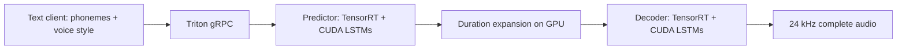

# Kokoro · TensorRT + Triton on Kubernetes

Run [Kokoro-82M](https://huggingface.co/hexgrad/Kokoro-82M) as a GPU speech service using [NVIDIA's ONNX model](https://huggingface.co/nvidia/kokoro-82M-onnx-opt), TensorRT, CUDA/cuDNN, and Triton Inference Server.

**Build → deploy → speak.** Kubernetes assigns the GPU. The container downloads pinned public weights, prepares the graph, builds TensorRT engines on that GPU, and starts serving. Models and engines survive restarts in a persistent volume.

This is a portable, single-GPU deployment. All paths are repository-relative or generic paths inside the container. Choose any checkout directory and registry. The client can run on a laptop; the server needs a supported NVIDIA GPU.

## 1. Prerequisites

| Component | Requirement |
| --- | --- |
| GPU node | Linux x86_64, NVIDIA GPU with compute capability 7.5 or newer |
| Driver | A driver compatible with CUDA 12.8; R570 or newer is a straightforward choice. See the [image's driver requirements](https://docs.nvidia.com/deeplearning/triton-inference-server/release-notes/rel-25-03.html#driver-requirements) for compatibility options. |
| Kubernetes | GPU-enabled cluster, NVIDIA Container Toolkit, and [NVIDIA device plugin](https://github.com/NVIDIA/k8s-device-plugin) or [GPU Operator](https://docs.nvidia.com/datacenter/cloud-native/gpu-operator/latest/). A node must advertise `nvidia.com/gpu`. |
| Storage | Default StorageClass supporting a 20 GiB `ReadWriteOnce` PVC, or set `STORAGE_CLASS` below |
| Your computer | Git, Docker, Make, kubectl configured for the target cluster; Python 3.10–3.12 for the client |
| Connectivity | Cluster nodes can pull your container; the pod can download public Hugging Face assets |

Start with one worker. GPU memory use depends on the model profiles, TensorRT workspace, and number of workers. CPU-only servers, AMD GPUs, and Apple GPUs cannot run this TensorRT deployment.

Check the target context and available GPU resources:

```bash
kubectl config current-context
kubectl get nodes
kubectl describe nodes
kubectl get storageclass
```

Install GPU support through your cluster administrator if `nvidia.com/gpu` is absent. These application manifests assume it is already configured; they do not modify node drivers or runtimes. Kubernetes GPU scheduling is documented [here](https://kubernetes.io/docs/tasks/manage-gpus/scheduling-gpus/).

## 2. Build and deploy

```bash
git clone https://github.com/bgiddwani-ai/kokoro-tensorrt-triton-k8s.git
cd kokoro-tensorrt-triton-k8s

# Replace this with a registry/tag you can push and your cluster can pull.
export IMAGE=registry.example.com/your-team/kokoro:v1
docker login registry.example.com

make build push IMAGE="$IMAGE"
make deploy IMAGE="$IMAGE"
```

The first startup downloads the model and compiles engines. Allow several minutes; the startup probe gives it up to 30 minutes. Deployment uses `Recreate` so upgrades release the existing GPU before requesting it again. This entails a brief outage during upgrades.

In another terminal, view startup progress:

```bash
make logs
```

For clusters requiring an explicit runtime or storage class:

```bash
make deploy IMAGE="$IMAGE" RUNTIME_CLASS=nvidia STORAGE_CLASS=your-storage-class
```

Only set `RUNTIME_CLASS` to a class that exists in your cluster. For a private image, create an image pull secret in the target namespace and add `imagePullSecrets` under `spec.template.spec` in [deployment.yaml](k8s/base/deployment.yaml) before deploying. Follow Kubernetes' [private registry instructions](https://kubernetes.io/docs/tasks/configure-pod-container/pull-image-private-registry/).

Preview the complete YAML without changing the cluster:

```bash
make render IMAGE="$IMAGE" > rendered.yaml
kubectl apply --dry-run=server -f rendered.yaml
```

## 3. Generate speech

Keep this command running in a separate terminal:

```bash
make forward
```

Install `espeak-ng` for the [frontend's pronunciation fallback](https://github.com/hexgrad/kokoro#usage): `brew install espeak-ng` on macOS, or `sudo apt-get install espeak-ng` on Debian/Ubuntu. Then install the Python client and generate a WAV:

```bash
python3.12 -m venv .venv
source .venv/bin/activate
python -m pip install -r requirements-client.txt

python -m kokoro_triton.client \
  --text "Hello! Your speech service is ready." \
  --voice af_heart \
  --out artifacts/hello.wav
```

The output is mono 24 kHz PCM WAV. `am_michael` is another voice to try. The supplied client installs English preprocessing; other languages may need additional [Kokoro/Misaki dependencies](https://github.com/hexgrad/kokoro).

Useful checks while port forwarding:

```bash
curl --fail http://localhost:8000/v2/health/ready
curl --fail http://localhost:8000/v2/models/kokoro/ready
curl --fail http://localhost:8002/metrics
```

Inside the same namespace, clients use `kokoro:8001`. From another namespace, use `kokoro.<namespace>.svc.cluster.local:8001`. The Service is `ClusterIP`; no external endpoint is created.

## Configuration

Supply these values to `make deploy` or `make render`. Use the same `NAMESPACE` for subsequent commands.

| Option | Default | Purpose |
| --- | --- | --- |
| `IMAGE` | Example placeholder | Your server image/tag or digest; required to deploy |
| `NAMESPACE` | `kokoro` | Kubernetes namespace |
| `WORKERS` | `1` | Triton Python processes sharing one GPU; more workers use more memory |
| `MPS` | `0` | Set `1` to start CUDA MPS inside the container |
| `WORKSPACE_MIB` | `2048` | TensorRT workspace allowance **per session**, not a total GPU memory cap |
| `MAX_TOKENS` | `500` | Maximum tokens per request, including two boundary tokens |
| `MAX_FRAMES` | `2000` | Maximum predicted acoustic frames; 2000 frames = 50 seconds at 24 kHz |
| `CACHE_EPOCH` | `1` | Increment to force fresh engines without removing the model download |
| `STORAGE_CLASS` | Cluster default | PVC StorageClass; choose before creating the PVC |
| `RUNTIME_CLASS` | Cluster default | Optional NVIDIA RuntimeClass |

For example, evaluate four workers and MPS on a GPU with enough memory:

```bash
make deploy IMAGE="$IMAGE" WORKERS=4 MPS=1 WORKSPACE_MIB=4096
```

MPS is optional and uses a private pipe directory shared by processes in the same container. Use a dedicated full GPU for this mode; do not combine it with device-plugin MPS sharing, time slicing, or MIG. No host PID/IPC namespace or privileged container is required by these manifests. See [NVIDIA MPS](https://docs.nvidia.com/deploy/mps/latest/index.html) for the underlying runtime behavior.

If memory is tight, keep `WORKERS=1`, reduce `WORKSPACE_MIB`, and try smaller shape limits:

```bash
make deploy IMAGE="$IMAGE" WORKERS=1 WORKSPACE_MIB=1024 MAX_TOKENS=250 MAX_FRAMES=1000
python -m kokoro_triton.client --max-tokens 250 --text "A shorter request."
```

Match the client's token limit to the server. Shorten text or increase speech speed if predicted audio exceeds the frame limit. CPU and host-memory requests/limits, PVC capacity, startup timeout, and optional scheduling rules are in [deployment.yaml](k8s/base/deployment.yaml) and [pvc.yaml](k8s/base/pvc.yaml). Configuration changes produce a new ConfigMap name and roll the Deployment.

Keep `replicas: 1` for this PVC-backed deployment. For multiple GPUs, deploy separate releases with distinct namespaces and PVCs. Do not scale this single `ReadWriteOnce` deployment across nodes.

## How the optimization works



The preparation code restores standard ONNX operators, promotes floating-point tensors to FP32, and splits the model around its variable-length duration expansion. ONNX Runtime's TensorRT execution provider handles supported subgraphs, while LSTMs use CUDA/cuDNN. CuPy keeps intermediate tensors on the GPU. Small shape/control operations can still run on the CPU. This is a hybrid TensorRT implementation served through Triton's Python backend; it is not a single TensorRT plan.

FP16 is disabled because reduced precision needs its own audio quality qualification. Automatic batching is disabled: the upstream graph is specialized to batch size one. Concurrency comes from worker processes, optionally overlapping through MPS. Choose workers using measurements on your GPU; there is no universal fastest configuration.

At startup the container primes the configured token/frame bounds, performs a finite-audio smoke check, and checks that both partitions produced TensorRT engines. Engines are cached under a hash of model/transform contents, GPU model and capability, driver/runtime versions, shape limits, and workspace settings. Moving to a different GPU stack creates a new cache. Startup validates cache loading before readiness.

Generic container directories:

| Path | Contents |
| --- | --- |
| `/app` | Application source baked into the image |
| `/data/models` | Prepared ONNX partitions and upstream license |
| `/data/engines/<cache-key>` | Target-generated TensorRT engines, timing cache, build metadata |
| `/data/huggingface` | Pinned public asset downloads |
| `/tmp/model_repository` | Generated Triton model repository |
| `/dev/shm` | Pod-local shared memory for the Python backend |

## Benchmark and compare with eager

See [docs/benchmarking.md](docs/benchmarking.md) for Kubernetes benchmark Jobs, the eager baseline, audio quality checks, and interpreting results. The 12-passage corpus covers short, medium, and long English text with two voices. Generated measurements belong to your hardware and workload; this repository does not embed deployment-specific performance claims.

For a quick client-side benchmark after forwarding the service:

```bash
python -m kokoro_triton.benchmark --concurrency 1,2,4,8,16,32 \
  --duration 30 --out artifacts/triton.json
```

## Troubleshooting

| Symptom | Check or change |
| --- | --- |
| Pod `Pending` | `kubectl -n kokoro describe pod <pod>`: available GPU, CPU/RAM requests, PVC binding, node taints |
| PVC `Pending` | Set a valid `STORAGE_CLASS`, or provide storage through your cluster's normal provisioning process |
| `ImagePullBackOff` | Registry URL/tag, pull access, and namespace image pull secret |
| TensorRT/CUDA library error | Use the supplied pinned image; verify the node driver and NVIDIA runtime |
| Long first startup | Read `make logs`; downloading and engine compilation happen before Triton starts |
| Out of GPU memory | One worker, smaller profiles, lower workspace; workspace is not a total memory limit |
| MPS startup error | Use `MPS=0`; check NVIDIA utility injection and dedicated GPU allocation |
| Frame limit error | Shorter utterance chunks or higher `--speed`; keep model limits at or below supported bounds |
| Bad/stale engine cache | Increment `CACHE_EPOCH` and redeploy |

## Stop the application

```bash
make down
```

This removes the Deployment and Service, releases the application's GPU allocation, and keeps the PVC/cache. Delete the PVC separately only when you want to discard its contents:

```bash
kubectl -n kokoro delete pvc kokoro-data
```

Stopping an application does not shut down Kubernetes worker machines. Manage node capacity through your infrastructure tooling.

## Development and validation

```bash
python3.12 -m venv .venv
source .venv/bin/activate
python -m pip install -r requirements-test.txt
make test
ruff check .
ruff format --check .
bash -n scripts/entrypoint.sh scripts/kube.sh
```

CPU tests check ONNX rewrite parity, request guards, duration expansion, cache keys, rendered Kustomize overrides, and Kubernetes schemas. GitHub Actions runs the same checks. They do not claim a successful GPU image build, TensorRT build, or live Kubernetes inference test. On a target cluster, complete deployment, readiness, WAV generation, benchmark, and quality checks to qualify that environment.

Optional: check the complete pinned graph on CPU. This downloads the public ONNX weights and needs additional RAM, but writes no prepared models or engines:

```bash
python -m pip install huggingface-hub==0.34.4
python -m kokoro_triton.check_model_cpu
```

## Versions and model provenance

The server pins Triton `25.03-py3` (Triton 2.56, TensorRT 10.9, CUDA 12.8) and ONNX Runtime GPU 1.22. This pairing follows the [Triton release notes](https://docs.nvidia.com/deeplearning/triton-inference-server/release-notes/rel-25-03.html) and [ORT TensorRT compatibility table](https://onnxruntime.ai/docs/execution-providers/TensorRT-ExecutionProvider.html#requirements). Keep these versions aligned when upgrading; requalify GPU execution and audio quality.

| Public asset | Pinned revision |
| --- | --- |
| `hexgrad/Kokoro-82M` config, voices, optional eager weights | `f3ff3571791e39611d31c381e3a41a3af07b4987` |
| `nvidia/kokoro-82M-onnx-opt` ONNX model | `4715915bc1a4af683ceb826a2d365d59ec666d13` |

The ONNX SHA256 is verified before transformation. Graph split points depend on that pinned model; review the transformations before changing its revision. Weights and target-specific engines are downloaded/generated at runtime and excluded from Git. See [LICENSE](LICENSE) and [NOTICE](NOTICE).
